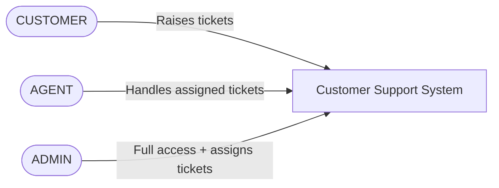
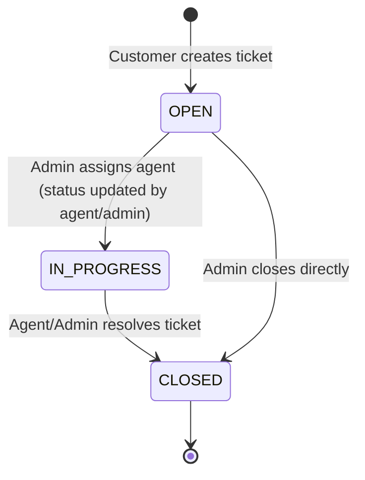
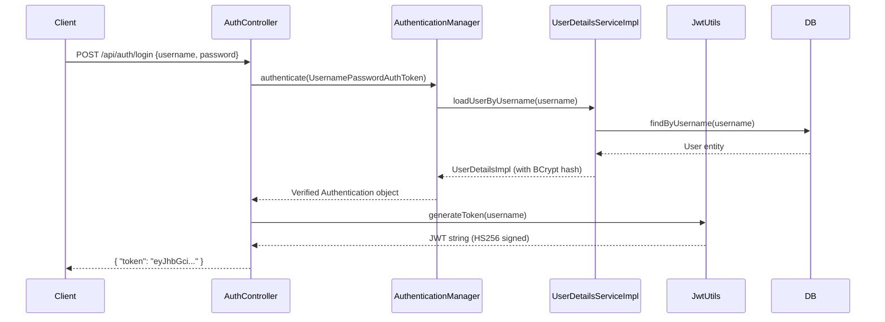
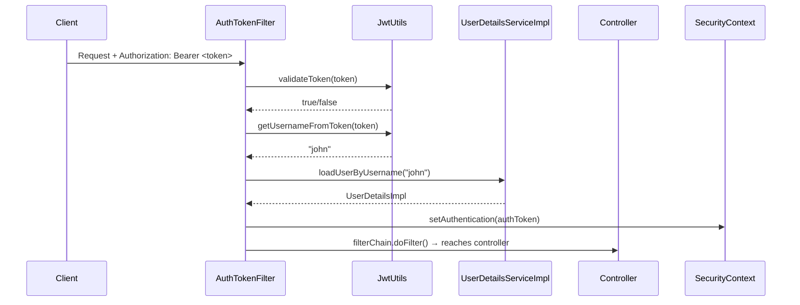
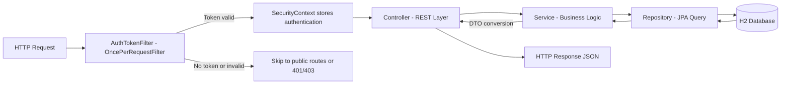
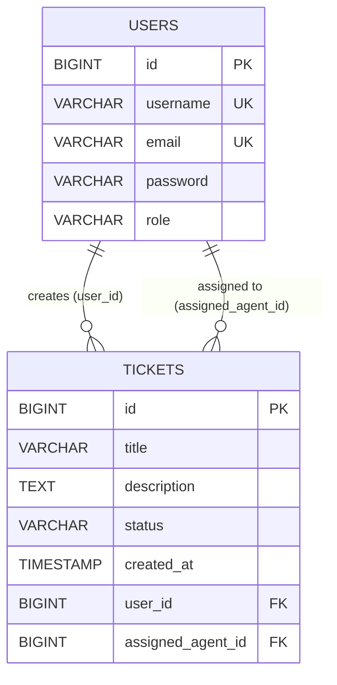
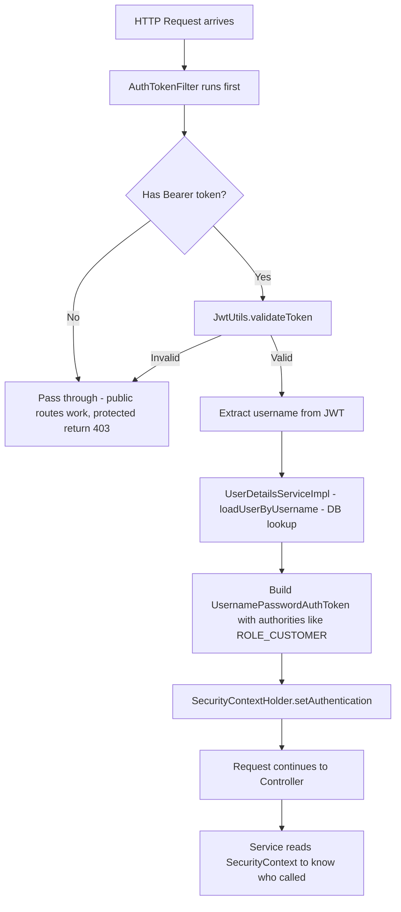

# Customer Support Assistant — Complete Developer Guide

---

## 1. Functional Overview

This is a **RESTful Customer Support Ticket Management System** built with **Spring Boot 3.2.5 + Java 17**. It lets customers raise support tickets, agents work on them, and admins oversee everything. The entire backend is stateless — secured with **JWT-based authentication** and role-based access control via **Spring Security**.

**Tech stack at a glance:**

| Layer | Technology |
|---|---|
| Framework | Spring Boot 3.2.5 |
| Language | Java 17 |
| Database | H2 In-Memory |
| ORM | Spring Data JPA / Hibernate |
| Security | Spring Security + JWT (jjwt 0.11.5) |
| Password Hashing | BCrypt |
| Validation | Jakarta Bean Validation |
| Build Tool | Maven |

---

## 2. Actors Involved



| Actor | Description |
|---|---|
| **CUSTOMER** | End-user who creates and views their own tickets |
| **AGENT** | Support staff who works on tickets assigned to them |
| **ADMIN** | System administrator — full visibility, assigns agents to tickets |

---

## 3. Features Supported

| # | Feature | Who Can Use |
|---|---|---|
| 1 | Register a user (any role) | Public |
| 2 | Login and get JWT token | Public |
| 3 | Create a support ticket | CUSTOMER, AGENT, ADMIN |
| 4 | View tickets (role-filtered + paginated) | CUSTOMER / AGENT / ADMIN |
| 5 | Assign a ticket to an agent | ADMIN only |
| 6 | Update ticket status (OPEN → IN_PROGRESS → CLOSED) | ADMIN / assigned AGENT |
| 7 | Get all users | Public |
| 8 | Get user by username | Authenticated |
| 9 | Get current logged-in user profile (`/me`) | Authenticated |
| 10 | Update user details | Authenticated |
| 11 | Delete user | Authenticated |
| 12 | H2 Console for DB inspection | Public (dev only) |

---

## 4. Ticket Lifecycle



| Status | Meaning |
|---|---|
| `OPEN` | Ticket just created, not yet picked up |
| `IN_PROGRESS` | Ticket assigned to an agent and being worked on |
| `CLOSED` | Issue resolved |

> Status transitions are enforced in `TicketService.updateTicketStatus()` — only the **assigned agent** or an **ADMIN** can change status.

---

## 5. User Roles

```mermaid
graph TD
    ADMIN -->|Can do everything| ALL[All Operations]
    ADMIN -->|Assigns tickets| ASSIGN[PUT /api/tickets/{id}/assign]
    ADMIN -->|Sees all tickets| ALLTICKETS[GET /api/tickets]

    AGENT -->|Sees assigned tickets| MYTICKETS[GET /api/tickets]
    AGENT -->|Updates status| STATUS[PUT /api/tickets/{id}/status]

    CUSTOMER -->|Creates tickets| CREATE[POST /api/tickets]
    CUSTOMER -->|Sees own tickets| OWNTICKETS[GET /api/tickets]
```

Role is stored as a string (`CUSTOMER`, `AGENT`, `ADMIN`) in the `USERS` table. Spring Security prefixes it as `ROLE_CUSTOMER`, `ROLE_AGENT`, `ROLE_ADMIN` via `UserDetailsImpl`.

---

## 6. Authentication Flow



**What happens on every subsequent request:**



---

## 7. End-to-End Request Flow



The `SecurityContextHolder` is the **shared state** within a request. The service layer reads `getAuthentication().getName()` to know who the caller is — no need to pass username as a method parameter.

---

## 8. Major Classes and Their Responsibilities

| Class | Package | Responsibility |
|---|---|---|
| `DemoApplication` | `demo` | Spring Boot entry point, starts embedded Tomcat |
| `User` | `model` | JPA entity mapped to `USERS` table; holds username, email, BCrypt password, role, tickets |
| `Ticket` | `model` | JPA entity mapped to `tickets` table; holds title, description, status, FK to user and agent |
| `Role` | `model` | Enum: `CUSTOMER`, `AGENT`, `ADMIN` |
| `TicketStatus` | `model` | Enum: `OPEN`, `IN_PROGRESS`, `CLOSED` |
| `UserRepository` | `repository` | Spring Data JPA interface; `findByUsername`, `existsByEmail`, `existsByUsername` |
| `TicketRepository` | `repository` | Spring Data JPA interface; paginated `findByUser`, `findByAssignedAgent` |
| `UserService` | `service` | CRUD for users; BCrypt encoding; reads `SecurityContext` for `/me` |
| `TicketService` | `service` | Create, list (role-aware), assign, update status; all role checks are here |
| `AuthController` | `controller` | `POST /api/auth/login` — delegates to `AuthenticationManager`, returns JWT |
| `UserController` | `controller` | CRUD for users (`/api/users`) + `/me` endpoint |
| `TicketController` | `controller` | CRUD + assign + status update for tickets (`/api/tickets`) |
| `JwtUtils` | `security` | Generates JWT with HS256, validates, extracts username from token |
| `AuthTokenFilter` | `security` | `OncePerRequestFilter` — reads `Authorization` header, validates JWT, sets SecurityContext |
| `UserDetailsImpl` | `security` | Wraps `User` entity as Spring Security's `UserDetails`; converts `ROLE` enum to `ROLE_XXX` authority |
| `UserDetailsServiceImpl` | `security` | Implements `UserDetailsService`; loads user from DB by username |
| `SecurityConfig` | `config` | Defines filter chain: CSRF off, stateless sessions, public vs protected routes, registers `AuthTokenFilter` |
| `AppConfig` | `config` | Declares `BCryptPasswordEncoder` as a Spring `@Bean` |
| `GlobalExceptionHandler` | `exception` | `@RestControllerAdvice` — catches `APIException` and validation errors, returns clean JSON errors |
| `APIException` | `exception` | Custom unchecked exception for business rule violations |

---

## 9. Database Tables and Relationships



- `USERS.role` stores `CUSTOMER`, `AGENT`, or `ADMIN` as a string (`@Enumerated(EnumType.STRING)`)
- `TICKETS.user_id` — who **created** the ticket (always a `CUSTOMER`)
- `TICKETS.assigned_agent_id` — which `AGENT` is handling it (nullable until assigned)
- `created_at` is auto-set by `@PrePersist` — never stored from client input
- `ddl-auto=create-drop` — schema is created on startup, dropped on shutdown (in-memory H2)

---

## 10. APIs with Request and Response Examples

### Auth

**POST /api/auth/login**
```json
// Request
{ "username": "john", "password": "pass123" }

// Response 200
{ "token": "eyJhbGciOiJIUzI1NiJ9.eyJzdWIiOiJqb2huIi..." }
```

---

### Users

**POST /api/users** — Create user (public)
```json
// Request
{ "username": "john", "email": "john@example.com", "password": "pass123", "role": "CUSTOMER" }

// Response 200
{ "id": 1, "username": "john", "email": "john@example.com", "role": "CUSTOMER" }
```

**GET /api/users** — List all users (public)
```json
// Response 200
[
  { "id": 1, "username": "john", "email": "john@example.com", "role": "CUSTOMER" },
  { "id": 2, "username": "sara", "email": "sara@example.com", "role": "AGENT" }
]
```

**GET /api/users/me** — Current user profile (requires token)
```json
// Response 200
{ "id": 1, "username": "john", "email": "john@example.com", "role": "CUSTOMER" }
```

**PUT /api/users/{id}** — Update user (requires token)
```json
// Request
{ "username": "john_updated", "email": "new@example.com" }

// Response 200
{ "id": 1, "username": "john_updated", "email": "new@example.com", "role": "CUSTOMER" }
```

**DELETE /api/users/{id}** — Delete user (requires token) → `204 No Content`

---

### Tickets

**POST /api/tickets** — Create ticket (requires token)
```json
// Request
{ "title": "Login issue", "description": "Cannot log in to the portal" }

// Response 200
{
  "id": 1,
  "title": "Login issue",
  "description": "Cannot log in to the portal",
  "status": "OPEN",
  "createdAt": "2026-08-05T10:30:00",
  "createdByUsername": "john",
  "assignedAgentUsername": null
}
```

**GET /api/tickets?page=0&size=5** — Get tickets (role-filtered, paginated)
```json
// Response 200
{
  "content": [
    {
      "id": 1,
      "title": "Login issue",
      "status": "OPEN",
      "assignedAgentUsername": null
    }
  ],
  "totalElements": 1,
  "totalPages": 1,
  "size": 5,
  "number": 0
}
```

**PUT /api/tickets/{id}/assign?username=sara** — Assign to agent (ADMIN only)
```json
// Response 200
{
  "id": 1,
  "title": "Login issue",
  "status": "OPEN",
  "assignedAgentUsername": "sara"
}
```

**PUT /api/tickets/{id}/status** — Update status (ADMIN or assigned AGENT)
```json
// Request
{ "status": "IN_PROGRESS" }

// Response 200
{
  "id": 1,
  "title": "Login issue",
  "status": "IN_PROGRESS",
  "assignedAgentUsername": "sara"
}
```

---

## 11. How Spring Security Works in This Project



**Key configuration decisions in `SecurityConfig`:**

| Setting | Value | Why |
|---|---|---|
| CSRF | Disabled | REST APIs are stateless; CSRF only matters for cookie-based sessions |
| Session policy | `STATELESS` | No server-side session — every request must carry its own JWT |
| `/api/auth/**` | `permitAll()` | Login endpoint must be reachable without a token |
| `/api/users` POST/GET | `permitAll()` | Registration and user listing are public |
| Everything else | `authenticated()` | Must carry a valid JWT |
| `AuthTokenFilter` position | Before `UsernamePasswordAuthenticationFilter` | JWT must be processed first |

---

## 12. How JWT Works in This Project

**Token structure** (three Base64-encoded parts separated by `.`):

```
eyJhbGciOiJIUzI1NiJ9        ← Header  { "alg": "HS256" }
.eyJzdWIiOiJqb2huIiwi...    ← Payload { "sub": "john", "iat": ..., "exp": ... }
.SflKxwRJSMeKKF2QT4fw...    ← Signature (HMAC-SHA256 of header+payload using secret key)
```

**Claims stored in this project:**

| Claim | Value |
|---|---|
| `sub` | username (e.g. `"john"`) |
| `iat` | issued-at timestamp |
| `exp` | iat + 86400000ms = 24 hours later |

**Secret key flow in `JwtUtils`:**

```
application.properties → jwt.secret (Base64 string)
    ↓ Decoders.BASE64.decode()
    ↓ Keys.hmacShaKeyFor(bytes)
    → javax.crypto.SecretKey (used for sign + verify)
```

**Validation logic:**

```
getClaims(token)  →  Jwts.parserBuilder()
                         .setSigningKey(key)
                         .build()
                         .parseClaimsJws(token)
```

If the signature doesn't match or the token is expired, `parseClaimsJws` throws an exception → `validateToken()` returns `false` → request is not authenticated.

---

## 13. Common Interview Questions from This Project

### Spring Security & JWT

**Q: Why is CSRF disabled?**
> CSRF attacks exploit cookie-based sessions. Since this API is stateless (JWT in `Authorization` header, not cookies), there is no session to hijack, so CSRF protection is unnecessary.

**Q: What is `OncePerRequestFilter`?**
> A Spring filter base class that guarantees `doFilterInternal()` is called exactly once per HTTP request, even if the request is forwarded internally.

**Q: Why is `STATELESS` session policy used?**
> With JWT, the server does not need to store session state. Each request is self-contained — the token carries identity. `STATELESS` prevents Spring from ever creating an `HttpSession`.

**Q: Where is the user's identity available in the service layer?**
> Through `SecurityContextHolder.getContext().getAuthentication().getName()` — the `AuthTokenFilter` stores authentication there before the request reaches the service.

**Q: Why does `UserDetailsImpl` prefix role with `ROLE_`?**
> Spring Security's `hasRole()` and `@PreAuthorize("hasRole('ADMIN')")` automatically prepend `ROLE_` when matching, so authorities must follow the `ROLE_X` convention.

**Q: What happens if the JWT secret changes after tokens are issued?**
> All previously issued tokens become invalid immediately because their signatures can no longer be verified with the new key.

---

### JPA & Database

**Q: What does `@JsonManagedReference` / `@JsonBackReference` solve?**
> Infinite recursion during JSON serialization. `User` has `List<Ticket>` and `Ticket` has `User` — without these annotations, Jackson would loop forever. `@JsonManagedReference` serializes forward; `@JsonBackReference` is ignored in serialization.

**Q: Why use DTOs instead of returning entities directly?**
> Entities expose internal structure (e.g., BCrypt password hash). DTOs give explicit control over what is returned. `UserResponse` excludes `password`; `TicketResponse` returns usernames instead of full `User` objects.

**Q: What does `@PrePersist` do on `createdAt`?**
> It is a JPA lifecycle callback — runs automatically just before the entity is first saved to the database, setting `createdAt` to the current time. The client cannot inject a fake timestamp.

**Q: How does pagination work?**
> `TicketController` accepts `?page=0&size=5`, creates a `PageRequest.of(page, size)` (a `Pageable`), and passes it to the repository. Spring Data JPA automatically adds `LIMIT` and `OFFSET` to the SQL query and wraps results in a `Page<T>` with metadata (`totalElements`, `totalPages`, etc.).

---

### Business Logic

**Q: How does the `getMyTickets` method handle different roles?**
> It reads the current username from `SecurityContext`, loads the user from DB to get their role, then branches: ADMIN gets `findAll()`, AGENT gets `findByAssignedAgent()`, CUSTOMER gets `findByUser()`.

**Q: Can an agent update status on a ticket assigned to someone else?**
> No. `updateTicketStatus` checks `ticket.getAssignedAgent().getUsername().equals(currentUsername)` — only the assigned agent or an admin can change status.

---

## 14. Real-World Scenario Explanation

**Scenario: A customer cannot log in — end-to-end walk-through**

```
1. REGISTER
   Sarah (customer) hits POST /api/users
   → UserService.createUser() BCrypt-encodes her password
   → User saved to USERS table with role=CUSTOMER

2. LOGIN
   Sarah hits POST /api/auth/login  { username: "sarah", password: "pass" }
   → AuthController asks AuthenticationManager to authenticate
   → AuthenticationManager calls UserDetailsServiceImpl → loads sarah from DB
   → BCrypt verifies password hash ✓
   → JwtUtils.generateToken("sarah") → returns eyJhbGci...
   → Sarah stores this token in her HTTP client

3. RAISE TICKET
   Sarah hits POST /api/tickets  (with Authorization: Bearer eyJhbGci...)
   → AuthTokenFilter reads token, validates it, sets SecurityContext as "sarah"
   → TicketService.createTicket() reads "sarah" from SecurityContext
   → New Ticket saved: status=OPEN, user_id=sarah's id

4. ADMIN ASSIGNS TICKET
   Admin hits PUT /api/tickets/1/assign?username=agent_bob
   → TicketService.assignTicket() checks current user role = ADMIN ✓
   → Ticket 1 updated: assigned_agent_id = bob's id

5. AGENT WORKS ON IT
   Bob hits GET /api/tickets  (with his JWT)
   → TicketService.getMyTickets() sees role=AGENT
   → Returns only tickets where assigned_agent_id = bob ✓
   → Bob hits PUT /api/tickets/1/status  { status: "IN_PROGRESS" }
   → TicketService checks: bob IS the assigned agent ✓
   → Status updated to IN_PROGRESS

6. RESOLUTION
   Bob hits PUT /api/tickets/1/status  { status: "CLOSED" }
   → Status updated to CLOSED
   → Sarah can see her ticket as CLOSED via GET /api/tickets
```

This flow demonstrates **stateless security** (no session on the server), **role-based data isolation** (each actor sees only what they are allowed to), and **clean separation of concerns** across Controller → Service → Repository layers.
